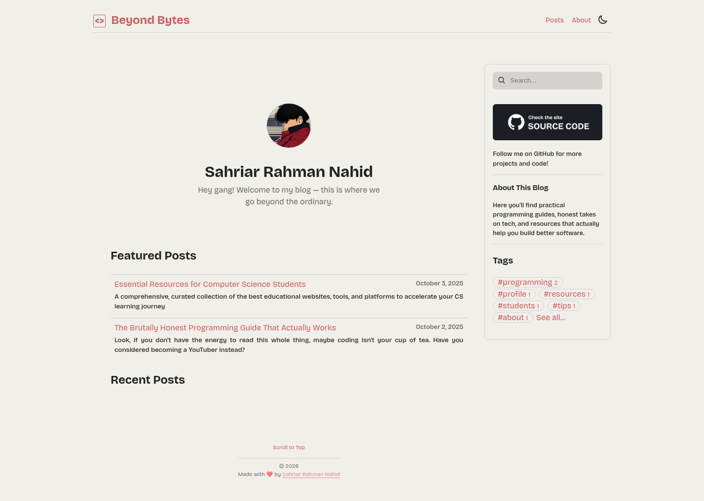

# 🚀 Beyond Bytes

**Where code meets creativity** — My personal space to share programming adventures, tech thoughts, and the stuff I wish I knew when I started coding.

<div align="center">

[](https://beyondbytes.pages.dev/)


[](https://beyondbytes.pages.dev/)

</div>

## Hey there! 👋

I'm **Nahid**, and this is my little corner of the internet where I dump everything I learn about programming. No corporate BS, no fluff – just real talk about code, the struggles, the wins, and the random 3 AM discoveries that make this whole journey worth it.

## What's Inside? 🎯

**Programming Guides** that actually make sense • **Comprehensive CS Resources** for students and professionals • **Tech reviews** without the marketing speak • **Curated Learning Lists** I actually use (not just bookmarked) • **Stories** from the trenches of development

### Latest Addition 📚
**Essential Resources for Computer Science Students** - A comprehensive, curated collection of 200+ educational websites, tools, and platforms organized by category to help CS students excel in their studies and career preparation.

## Cool Features ✨

- **Lightning fast** ⚡ because ain't nobody got time for slow sites
- **Mobile-friendly** 📱 for those late-night coding sessions in bed
- **Smart search** 🔍 to find that thing you read last month
- **Clean design** 🎨 that won't hurt your eyes

## Built With 🛠️

Hugo, modern web tech, responsive design, client-side search, automated deployments on Cloudflare Pages, and a lot of coffee ☕

## Deployment ☁️

The site is live at **[beyondbytes.pages.dev](https://beyondbytes.pages.dev/)** and is deployed to [Cloudflare Pages](https://developers.cloudflare.com/pages/) from the `main` branch.

Use these settings when creating the Pages project (Git integration):

| Setting | Value |
| --- | --- |
| Project name | `beyondbytes` |
| Production branch | `main` |
| Build command | `hugo --gc --minify` |
| Build output directory | `public` |
| Environment variable | `HUGO_VERSION` = `0.150.1` |

Set `HUGO_VERSION` for **both** the Production and Preview environments, otherwise Pages may build with an older Hugo release. The theme is a Git submodule and is cloned automatically during the Pages build.

To deploy manually instead, build the site and upload the output with Wrangler:

```sh
hugo --gc --minify
npx wrangler pages deploy
```

`wrangler.toml` already points Wrangler at the `public` output directory and the `beyondbytes` Pages project. If your Pages project uses a different name, update `name` in `wrangler.toml` to match it.

## Live Site 🌐

Check it out: **[beyondbytes.pages.dev](https://beyondbytes.pages.dev/)**

---

<div align="center">

**Made with ❤️ and probably too much caffeine**

_Building the future, one byte at a time._

[](https://github.com/sahriarnahid)
[](https://beyondbytes.pages.dev/)

</div>
